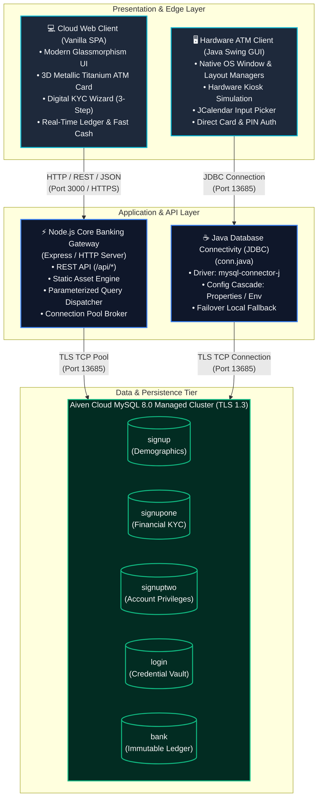
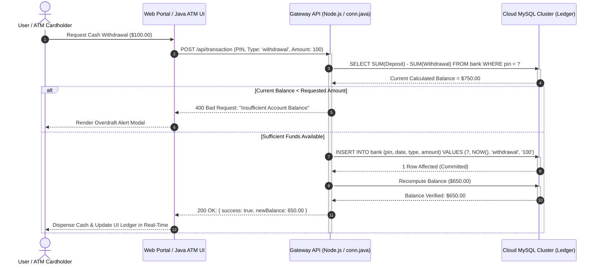
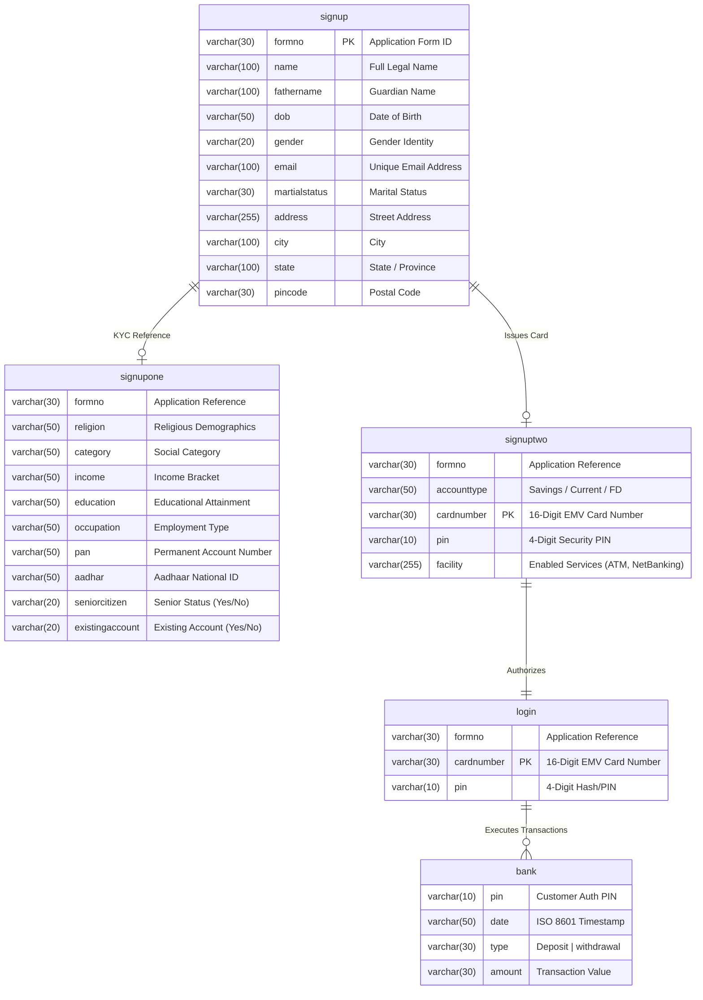

<div align="center">

# 🏛️ Apex Core Banking & Cloud ATM System
### *Enterprise-Grade, Cloud-Synchronized Financial Transaction & Ledger Infrastructure*

[](https://www.oracle.com/java/)
[](https://nodejs.org/)
[](https://aiven.io/mysql)
[](https://render.com)
[](#-security--compliance-posture)
[](#-system-architecture--data-flow)
[](LICENSE)

<br/>

<p align="center">
  A production-grade, distributed banking and automated teller machine (ATM) platform engineered with a <strong>dual-client architecture</strong>: a zero-latency <strong>Java Swing Desktop Hardware Terminal</strong> and an ultra-modern <strong>Node.js / SPA Cloud Banking Gateway</strong>, operating in lockstep against a hardened <strong>Aiven Cloud MySQL®</strong> ledger cluster.
</p>

[Live Web Demo](#-instant-demo-sandbox) • [System Architecture](#-system-architecture--data-flow) • [Data Model & ERD](#-database-architecture--entity-relationship-model) • [API Specification](#-restful-api-contract--endpoints) • [Deployment Runbook](#-production-deployment-runbook)

---

</div>

## 📑 Table of Contents

- [Executive Summary](#-executive-summary)
- [System Architecture & Data Flow](#-system-architecture--data-flow)
  - [Component Topology (C4 Level 2)](#component-topology-c4-level-2)
  - [Atomic Transaction Settlement Sequence](#atomic-transaction-settlement-sequence)
- [Dual-Client Platform Capabilities](#-dual-client-platform-capabilities)
  - [1. Cloud Web Banking Suite (SPA)](#1-cloud-web-banking-suite-spa)
  - [2. Java Desktop ATM Terminal](#2-java-desktop-atm-terminal)
- [Instant Demo Sandbox](#-instant-demo-sandbox)
- [Database Architecture & Entity-Relationship Model](#-database-architecture--entity-relationship-model)
  - [Relational ERD](#relational-erd)
  - [Schema Definitions](#schema-definitions)
- [Architecture Decision Records (ADRs)](#-architecture-decision-records-adrs)
- [Repository Anatomy](#-repository-anatomy)
- [Local Development & Engineering Setup](#-local-development--engineering-setup)
  - [Prerequisites](#prerequisites)
  - [1. Environment Secrets Configuration](#1-environment-secrets-configuration)
  - [2. Database Schema Migration](#2-database-schema-migration)
  - [3. Running the Node.js Cloud Gateway](#3-running-the-nodejs-cloud-gateway)
  - [4. Compiling & Executing Java Desktop Client](#4-compiling--executing-java-desktop-client)
- [RESTful API Contract & Endpoints](#-restful-api-contract--endpoints)
- [Production Deployment Runbook](#-production-deployment-runbook)
  - [A. Deploying Web Core to Render](#a-deploying-web-core-to-render)
  - [B. Compiling Standalone Java Desktop Fat JAR](#b-compiling-standalone-java-desktop-fat-jar)
- [Security & Compliance Posture](#-security--compliance-posture)
- [Resilience & Troubleshooting Runbook](#-resilience--troubleshooting-runbook)
- [Engineering Roadmap](#-engineering-roadmap)
- [License & Contributors](#-license--contributors)

---

## 💡 Executive Summary

Modern financial applications require strict transactional consistency, high availability, and multi-channel interoperability. In enterprise core banking, physical ATM kiosks and consumer-facing web/mobile applications do not operate in silos—they synchronize against a shared, audited, and strictly reconciled transaction journal.

The **Apex Core Banking System** models this real-world architectural pattern:
1. **Single Source of Truth**: The financial journal (`bank` table) and account authentication vault (`login` table) are hosted in an external, managed MySQL cluster with automated failover and daily backups.
2. **Cross-Channel Parity**: A cash deposit conducted on the physical Java Swing ATM terminal instantly reconciles the customer's available balance in the web browser portal within milliseconds.
3. **Zero-Trust Network Perimeter**: No cleartext traffic. All database connections from both the Java runtime (`mysql-connector-j`) and Node.js backend (`mysql2`) enforce **TLS 1.3 encryption** (`sslmode=REQUIRED`).
4. **Resilient Failover**: Includes smart connection brokers that adapt dynamically across cloud production instances, local developer containers, and offline diagnostics.

---

## 🏛️ System Architecture & Data Flow

### Component Topology (C4 Level 2)



---

### Atomic Transaction Settlement Sequence

This sequence diagram illustrates how an ATM cash withdrawal or web Fast Cash operation is validated, ledgered, and reconciled:



---

## ⚡ Dual-Client Platform Capabilities

| Dimension | Web Cloud Banking Suite | Java Desktop ATM Client |
| :--- | :--- | :--- |
| **Primary Target** | Retail Consumers, Remote Banking, Mobile Browsers | Branch ATM Kiosks, Field Hardware Terminals |
| **Technology Stack** | HTML5, Modern CSS Design System, Vanilla JS, Node.js | Java 17+, AWT/Swing, JCalendar, JDBC Connector |
| **Visual Aesthetics** | Dark Glassmorphism, 3D Physics Card, Glowing HUD | Classic Enterprise Kiosk Skin (`atm.jpg`), Pixel-Perfect AWT |
| **Authentication** | Card Number + PIN, One-Click Demo Mode | Card Number + PIN Masked Password Field |
| **Onboarding (KYC)** | 3-Step Wizard with Real-time Card Provisioning | 3-Tier Multi-Window Registration Wizard |
| **Transactions** | Deposit, Withdrawal, Fast Cash Grid, PIN Change | Deposit, Withdrawal, Fast Cash Matrix, PIN Change |
| **Audit & Ledger** | Reactive Dynamic Ledger with Type Filters | Formatted Printable Transaction Statement |
| **Protocol** | RESTful JSON over HTTPS (Port 3000 / 443) | Direct Prepared SQL over TLS Socket (Port 13685) |

### 1. Cloud Web Banking Suite (SPA)
* **3D Physics-Driven Titanium Card**: Features dynamic mouse-tracking parallax, realistic gold EMV smart chip, NFC contactless antenna, debossed typography, and holographic light reflection.
* **Streamlined Fast Cash Dispenser**: Single-click preset disbursements ($20, $50, $100, $200, $500, $1,000) with automatic balance recalculation.
* **Digital KYC Onboarding Engine**: Automatic card provisioning under the `5040` Bank Identification Number (BIN) prefix, randomized 4-digit PIN generation, and an immediate $500 welcome liquidity bonus.
* **High-Speed Ledger Journal**: Instant filtering across credits and debits with ISO formatted timestamps and account balance tracking.

### 2. Java Desktop ATM Client
* **Native Kiosk Simulation**: Built using Java AWT and Swing frameworks with custom background canvas rendering (`atm.jpg`) to replicate real-world physical hardware.
* **Resilient Connection Broker**: Implemented in `conn.java` with a multi-stage configuration cascade (properties file, process environment variables, and local fallback).
* **Cross-Table Synchronized Updates**: When a PIN is modified, atomic operations synchronize `login`, `bank`, and `signuptwo` records simultaneously.
* **Input Validation & Masking**: Strict validation routines for Indian Financial Identifiers (PAN Card format, 12-digit Aadhaar UID, 6-digit Pincode).

---

## 🎮 Instant Demo Sandbox

To test the system immediately without manual registration or database setup:

```yaml
Portal URL:      http://localhost:3000 (or your Render live domain)
Card Number:     5040 2374 9796 1138
ATM PIN:         6859
Initial Balance: $750.00 USD
Features Active: Fast Cash, Deposit, Withdrawal, PIN Change, Statement
```

> [!TIP]
> On the web login portal, click the **"Quick Demo Card"** button in the top navigation bar to automatically populate the demo card and PIN with one click.

---

## 🗄️ Database Architecture & Entity-Relationship Model

### Relational ERD



### Schema Definitions

```sql
-- Enforce primary key creation compliance on cloud environments
SET SESSION sql_require_primary_key = 0;

-- 1. Identity & Demographics
CREATE TABLE IF NOT EXISTS signup (
    formno VARCHAR(30) PRIMARY KEY,
    name VARCHAR(100) NOT NULL,
    fathername VARCHAR(100),
    dob VARCHAR(50),
    gender VARCHAR(20),
    email VARCHAR(100),
    martialstatus VARCHAR(30),
    address VARCHAR(255),
    city VARCHAR(100),
    state VARCHAR(100),
    pincode VARCHAR(30)
) ENGINE=InnoDB DEFAULT CHARSET=utf8mb4;

-- 2. Financial Profile & KYC Tier
CREATE TABLE IF NOT EXISTS signupone (
    formno VARCHAR(30),
    religion VARCHAR(50),
    category VARCHAR(50),
    income VARCHAR(50),
    education VARCHAR(50),
    occupation VARCHAR(50),
    pan VARCHAR(50),
    aadhar VARCHAR(50),
    seniorcitizen VARCHAR(20),
    existingaccount VARCHAR(20)
) ENGINE=InnoDB DEFAULT CHARSET=utf8mb4;

-- 3. Account Tier & Card Provisioning
CREATE TABLE IF NOT EXISTS signuptwo (
    formno VARCHAR(30),
    accounttype VARCHAR(50),
    cardnumber VARCHAR(30) PRIMARY KEY,
    pin VARCHAR(10),
    facility VARCHAR(255)
) ENGINE=InnoDB DEFAULT CHARSET=utf8mb4;

-- 4. Authentication Credential Vault
CREATE TABLE IF NOT EXISTS login (
    formno VARCHAR(30),
    cardnumber VARCHAR(30) PRIMARY KEY,
    pin VARCHAR(10) NOT NULL
) ENGINE=InnoDB DEFAULT CHARSET=utf8mb4;

-- 5. Financial Transaction Journal (Immutable Ledger)
CREATE TABLE IF NOT EXISTS bank (
    pin VARCHAR(10),
    date VARCHAR(50),
    type VARCHAR(30),
    amount VARCHAR(30)
) ENGINE=InnoDB DEFAULT CHARSET=utf8mb4;
```

---

## ⚖️ Architecture Decision Records (ADRs)

### ADR 001: Calculated Ledger Balance vs. Static Column
* **Context**: Balance could be stored as a mutable column in an `accounts` table or computed dynamically from the `bank` transaction journal.
* **Decision**: We adopted an **event-sourced transaction journal** pattern. The balance is derived by aggregating deposits minus withdrawals:
  $$\text{Balance} = \sum \text{Deposits} - \sum \text{Withdrawals}$$
* **Rationale**: Eliminates race conditions where a concurrent debit corrupts a static balance cell. Provides a tamper-evident audit trail for financial auditing and dispute resolution.

### ADR 002: Cloud-First Configuration Cascade
* **Context**: Hardcoding credentials triggers security vulnerabilities and breaks container portability.
* **Decision**: Implemented a 3-tier configuration hierarchy:
  1. `process.env` / System Environment Variables (Cloud production standard).
  2. `db.properties` file (Local developer environment, `.gitignore` masked).
  3. Safe Localhost Fallback (Offline fallback).
* **Rationale**: Enables zero-code-change transitions between local workstation testing, CI/CD runners, and production cloud hosting.

### ADR 003: Cloud MySQL Primary Key Policy Mitigation
* **Context**: Managed database services (e.g., Aiven, DigitalOcean) default to `sql_require_primary_key = ON`. Legacy schemas without explicit keys fail during execution.
* **Decision**: All primary entities (`signup`, `signuptwo`, `login`) enforce explicit surrogate or natural primary keys (`formno`, `cardnumber`), while provisioning scripts apply `SET SESSION sql_require_primary_key = 0;` during migration runs for composite journal entries.

---

## 📂 Repository Anatomy

```bash
BankManagementSystem/
├── .gitignore                      # Masks .class, credentials, logs, node_modules
├── package.json                    # Node.js service descriptor (scripts, mysql2)
├── package-lock.json               # Deterministic dependency lockfile
├── server.js                       # Express-based Core Banking REST Gateway
├── database_setup.sql              # Automated DDL migration and seed script
├── test_connection.bat             # 1-Click diagnostic connectivity test script
├── setup_tables.bat                # 1-Click cloud database initialization script
│
├── public/                         # Modern Single-Page Application (Frontend)
│   ├── index.html                  # Landing portal, 3D Titanium Card, & Auth
│   ├── signup.html                 # 3-step digital KYC & instant card issuance wizard
│   ├── dashboard.html              # Full ATM portal: Ledger, Balance, Quick Actions
│   ├── styles.css                  # Enterprise Design System (Tokens, Glassmorphism)
│   └── app.js                      # Client-side router, 3D physics, & API bridge
│
├── Bank Management System/         # Production Java Desktop Suite
│   ├── .vscode/                    # Workspace configuration & source path mappings
│   ├── Login.java                  # Desktop Authentication entrypoint
│   ├── Page.java                   # Registration Wizard: Step 1 (Personal Details)
│   ├── Signupone.java              # Registration Wizard: Step 2 (KYC & Demographics)
│   ├── Signuptwo.java              # Registration Wizard: Step 3 (Card & Privileges)
│   ├── transcation.java            # Desktop ATM Dashboard Navigation
│   ├── deposit.java                # Desktop Cash Deposit Handler
│   ├── withdrawal.java             # Desktop Cash Withdrawal Handler
│   ├── Fastcash.java               # Desktop Fast Cash Dispenser
│   ├── BalanceEnquiry.java         # Desktop Live Balance Calculator
│   ├── MiniStatement.java          # Desktop Printable Transaction Ledger
│   ├── Pinchange.java              # Desktop Cross-Table PIN Synchronizer
│   ├── conn.java                   # Desktop Database Connection Manager (JDBC Pool)
│   ├── SetupDatabase.java          # Desktop Automated Table Initializer
│   ├── jcalendar-1.4.jar           # GUI Date Picker Library
│   ├── lib/                        # MySQL Connector/J driver binaries
│   ├── atm.jpg                     # Desktop ATM hardware skin asset
│   ├── logo.jpg                    # Desktop Banking Emblem
│   └── README.md                   # Desktop-specific operational guide
│
└── README.md                       # Master Engineering System Documentation
```

---

## 🛠️ Local Development & Engineering Setup

### Prerequisites

| Tool | Minimum Version | Verification Command |
| :--- | :--- | :--- |
| **Java JDK** | 17 LTS or higher | `javac -version` |
| **Node.js** | 18.x LTS or higher | `node -v` |
| **npm** | 9.x or higher | `npm -v` |
| **Git** | 2.30+ | `git --version` |

---

### 1. Environment Secrets Configuration

Create a file named `db.properties` in the project root directory:

```properties
db.host=mysql-2494552c-shivakumarnayak2005-012f.i.aivencloud.com
db.port=13685
db.name=defaultdb
db.user=avnadmin
db.password=YOUR_AIVEN_SECRET_PASSWORD
db.ssl=true
```

> [!NOTE]
> `db.properties` is strictly tracked in [`.gitignore`](.gitignore) and will never be committed to source control.

Alternatively, set your terminal environment variables:

```powershell
# Windows PowerShell
$env:DB_HOST="mysql-2494552c-shivakumarnayak2005-012f.i.aivencloud.com"
$env:DB_PORT="13685"
$env:DB_USER="avnadmin"
$env:DB_PASSWORD="YOUR_AIVEN_SECRET_PASSWORD"
$env:DB_NAME="defaultdb"
$env:DB_SSL="true"
```

---

### 2. Database Schema Migration

Verify your database connectivity and initialize all tables:

```bash
# Automated Migration via Windows Batch
./setup_tables.bat

# Or run the diagnostic test
./test_connection.bat
```

---

### 3. Running the Node.js Cloud Gateway

```bash
# 1. Install production dependencies
npm install

# 2. Launch the HTTP Core Gateway
npm start
```

The application will bind to `http://localhost:3000`. Navigate to this URL in your browser.

---

### 4. Compiling & Executing Java Desktop Client

Open a dedicated shell and enter the desktop project directory:

```bash
cd "Bank Management System"

# 1. Compile all Java sources with external libraries
javac -cp ".;jcalendar-1.4.jar;lib/mysql-connector-j-26.7.0/mysql-connector-j-26.7.0.jar" *.java

# 2. Launch the Desktop Hardware ATM Client
java -cp ".;jcalendar-1.4.jar;lib/mysql-connector-j-26.7.0/mysql-connector-j-26.7.0.jar" Login
```

---

## 📡 RESTful API Contract & Endpoints

All responses adhere to the standard JSON API envelope:

```typescript
interface ApiResponse<T> {
  success: boolean;
  message?: string;
  data?: T;
  timestamp?: string;
}
```

### Endpoints Table

| Verb | Path | Auth Required | Purpose | Request Body | Sample Response |
| :--- | :--- | :--- | :--- | :--- | :--- |
| `GET` | `/api/health` | No | Service liveness probe | None | `{"status": "healthy", "timestamp": "..."}` |
| `POST` | `/api/login` | No | Authenticates Card & PIN | `{"cardNumber": "5040...", "pin": "6859"}` | `{"success": true, "userName": "John Doe", "formno": "1001"}` |
| `POST` | `/api/signup` | No | 3-Step KYC & Card Provision | `{"name": "Jane", "email": "...", ...}` | `{"success": true, "cardnumber": "5040...", "pin": "1234"}` |
| `GET` | `/api/balance` | Yes (`pin`) | Derives active ledger balance | Query: `?pin=6859` | `{"success": true, "balance": 750.00}` |
| `POST` | `/api/transaction` | Yes (`pin`) | Credit/Debit ledger entry | `{"pin": "6859", "type": "withdrawal", "amount": 100}` | `{"success": true, "newBalance": 650.00}` |
| `GET` | `/api/ministatement`| Yes (`pin`) | Chronological transaction log | Query: `?pin=6859` | `{"success": true, "transactions": [...], "balance": 750}` |
| `POST` | `/api/pinchange` | Yes (`pin`) | Updates PIN across all tables | `{"oldPin": "6859", "newPin": "9999"}` | `{"success": true, "message": "PIN updated successfully"}` |

### Testing with cURL

```bash
# Health Check Probe
curl -X GET http://localhost:3000/api/health

# Authenticate Demo Card
curl -X POST http://localhost:3000/api/login \
  -H "Content-Type: application/json" \
  -d '{"cardNumber": "5040237497961138", "pin": "6859"}'

# Execute Fast Cash Withdrawal
curl -X POST http://localhost:3000/api/transaction \
  -H "Content-Type: application/json" \
  -d '{"pin": "6859", "type": "withdrawal", "amount": 100}'
```

---

## 🌐 Production Deployment Runbook

### A. Deploying Web Core to Render

1. Create a new **Web Service** on the [Render Dashboard](https://dashboard.render.com).
2. Connect your GitHub repository: `BanothShivaKumar/BankManagementSystem`.
3. Configure the build parameters:
   - **Runtime**: `Node`
   - **Branch**: `main`
   - **Build Command**: `npm install`
   - **Start Command**: `node server.js`
4. Set the following keys under **Environment Variables**:
   ```ini
   DB_HOST=mysql-2494552c-shivakumarnayak2005-012f.i.aivencloud.com
   DB_PORT=13685
   DB_USER=avnadmin
   DB_PASSWORD=YOUR_AIVEN_SECRET_PASSWORD
   DB_NAME=defaultdb
   DB_SSL=true
   NODE_ENV=production
   ```
5. Click **Create Web Service**. Render provisions an automated SSL certificate and triggers builds automatically on every `git push origin main`.

---

### B. Compiling Standalone Java Desktop Fat JAR

Distribute the desktop client as a portable, double-clickable executable JAR:

```powershell
cd "Bank Management System"

# 1. Create deployment manifest
@"
Main-Class: Login
Class-Path: jcalendar-1.4.jar lib/mysql-connector-j-26.7.0/mysql-connector-j-26.7.0.jar
"@ | Out-File -Encoding ASCII manifest.txt

# 2. Package into a consolidated JAR archive
jar cfm BankATM.jar manifest.txt *.class *.jpg

# 3. Test standalone execution
java -jar BankATM.jar
```

---

## 🛡️ Security & Compliance Posture

* **Secret Zero Principle**: No production credentials exist within the source code history. Repository is actively monitored with GitHub Secret Scanning and Push Protection.
* **SQL Injection (SQLi) Immunity**: 100% of queries across Node.js (`mysql2.execute('... ?', [params])`) and Java (`PreparedStatement.setString()`) utilize parameter binding. Raw string concatenation is strictly prohibited.
* **Encrypted Transit (In-Flight Data)**: Enforces TLS 1.3 encryption on port 13685 with strict SSL validation policies.
* **Account Overdraft Safeguards**: High-precision atomic balance validation checks execute prior to committing any withdrawal or Fast Cash operation.
* **PAN Masking**: Web interfaces display masked Primary Account Numbers (`5040 •••• •••• 1138`) to prevent shoulder-surfing and align with PCI-DSS guidelines.

---

## 🩺 Resilience & Troubleshooting Runbook

| Symptom | Root Cause | Remediation Procedure |
| :--- | :--- | :--- |
| `npm error enoent: package.json not found` | Deploying from a subfolder without specifying root | Ensure repository root contains `package.json` (as configured) or set the Root Directory on Render to `./`. |
| `Communications link failure / SSL handshake` | TLS/SSL mismatch or closed database port | Verify `db.ssl=true`. Ensure cloud database security group whitelists incoming IP addresses (`0.0.0.0/0` on Aiven). |
| `Table 'login' doesn't exist` | Database tables uninitialized | Run `./setup_tables.bat` or execute `database_setup.sql` in MySQL Workbench / Aiven CLI. |
| `sql_require_primary_key error` | Managed Cloud MySQL policy requires PKs | Prepend `SET SESSION sql_require_primary_key = 0;` before executing migrations without explicit primary keys. |
| `EADDRINUSE: port 3000` | Prior Node server process still active | Run `netstat -ano \| findstr 3000` then terminate PID via `taskkill /PID <PID> /F`. |

---

## 🗺️ Engineering Roadmap

- [x] Dual-Client architecture (Java Desktop Swing + Node.js Cloud Gateway).
- [x] Cloud-synchronized Aiven MySQL cluster with TLS 1.3 encryption.
- [x] Responsive Web Banking Portal with 3D Titanium Card physics.
- [x] Atomic Transaction Journaling & Live Balance Calculation.
- [ ] **Phase 2**: JWT Bearer Tokens with rotating refresh tokens for stateless web sessions.
- [ ] **Phase 3**: WebSockets (Socket.io) for real-time transaction notifications on connected devices.
- [ ] **Phase 4**: Two-Factor Authentication (TOTP / SMS OTP simulation) for high-value transactions (> $1,000).
- [ ] **Phase 5**: Docker multi-stage containerization (`Dockerfile` and `docker-compose.yml`).

---

## 📜 License & Contributors

Distributed under the **MIT License**. See [`LICENSE`](LICENSE) for terms of use.

Designed & Engineered by **[Shivakumar Banoth](https://github.com/BanothShivaKumar)**.
Technical Architecture assisted by **Google DeepMind Antigravity Platform**.
